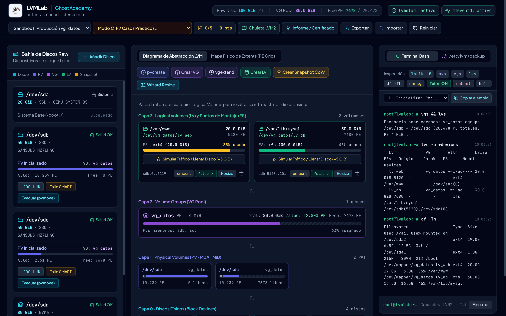
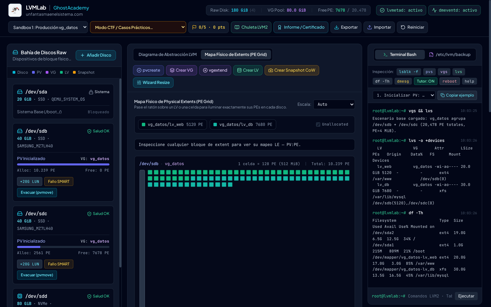
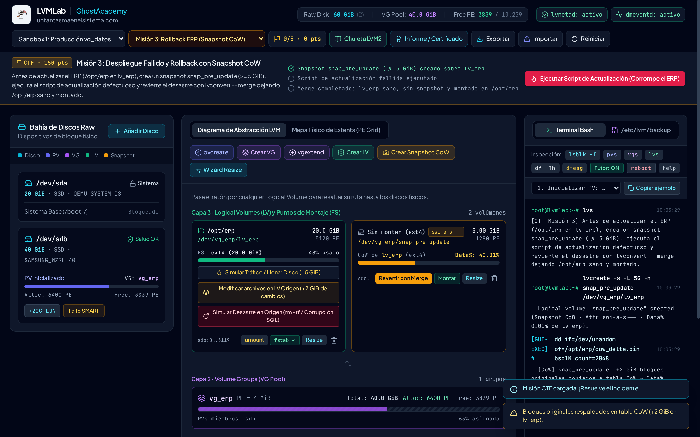
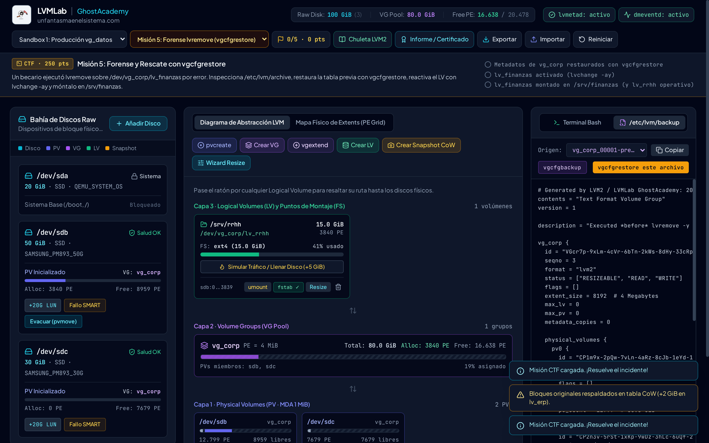
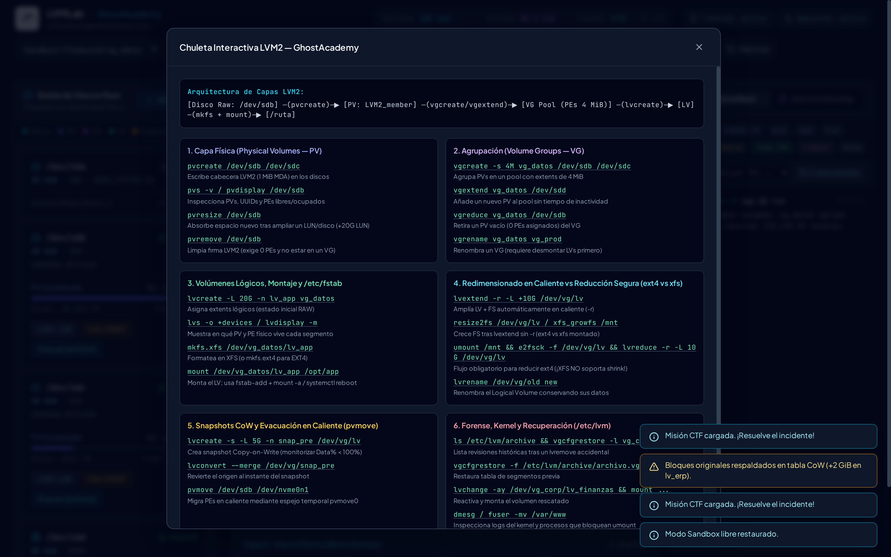

<div align="center">
  
  <h1>LVMLab — Simulador Interactivo de Linux LVM2</h1>
  <p>
    <strong>Laboratorio visual y consola Linux Zero-Backend para dominar Logical Volume Manager (LVM2)</strong><br />
    Proyecto educativo de <a href="https://www.unfantasmaenelsistema.com/">GhostAcademy (unfantasmaenelsistema)</a>
  </p>
  <p>
    <a href="https://unfantasmaenelsistema.github.io/LVMLab/"><strong>▶ Abrir LVMLab en el navegador</strong></a>
  </p>

  <p>
    
    
    
    
    
  </p>
</div>

---

**LVMLab** es un simulador web interactivo, autónomo y 100% client-side diseñado para aprender y practicar administración de almacenamiento Linux con **LVM2** sin riesgo de destruir discos reales. Sincroniza en tiempo real un **diagrama multicapa interactivo**, un **mapa físico de Physical Extents (PE Grid)**, un **inspector forense de metadatos (`/etc/lvm/backup` y `/etc/lvm/archive`)** y una **terminal Linux (`root@lvmlab:~#`)** con parser de comandos fiel a Debian/RHEL.

---

## Capturas Reales de la Aplicación

### 1. Vista Principal: Diagrama Multicapa, Bahía Hot-Swap y Consola Sincronizada
> Visualización bidireccional entre hardware físico, Physical Volumes (con cabecera MDA de 1 MiB), Volume Groups, Logical Volumes, `/etc/fstab` y terminal Linux con `[GUI-EXEC]` y **Modo Tutor**.



### 2. Mapa Físico de Extents (PE Grid) y Trazabilidad LE ↔ PV:PE
> Inspección celda a celda de cómo cada Logical Extent (LE) se distribuye sobre segmentos físicos en uno o varios discos (incluyendo striping/concatenación, espacio libre y espejo temporal `pvmove0`).



### 3. Misiones CTF Guiadas y Snapshots Copy-on-Write (CoW)
> Simulación interactiva del buffer Copy-on-Write (`swi-a-s---`, `Data%`), invalidación por desbordamiento (`Iwi---s---`) y restauración mediante `lvconvert --merge`.



### 4. Inspector de Metadatos (`/etc/lvm/backup` y `/etc/lvm/archive`) y Forense
> Generación automática de ficheros `.vg` en formato real de LVM2 tras cada operación y recuperación ante borrados accidentales con `vgcfgrestore`.



### 5. Chuleta Interactiva LVM2 Integrada
> Referencia rápida categorizada por capas, redimensionado `ext4` vs `xfs`, snapshots, evacuación en caliente y diagnóstico del kernel.



---

## Características Principales

- **Arquitectura de Almacenamiento Realista (LVM2):**
  - Cabecera de metadatos **MDA de 1 MiB** descontada automáticamente en cada `pvcreate` / `pvresize`.
  - **Physical Extents (PE)** configurables en `vgcreate -s` (por defecto `4 MiB`, soporta `2M`, `4M`, `8M`, `16M`, `32M`, `64M`).
  - Segmentación exacta (`segments`) con mapeo `LE ↔ PV:PE` visible tanto en `lvs -o +devices` y `lvdisplay -m` como al pasar el ratón por cualquier LV en el diagrama o en el PE Grid.
- **Hardware Hot-Swap y Escalado de LUNs:**
  - Añadir discos virtuales (`SSD`, `NVMe`, `HDD`) en caliente.
  - Ampliar el tamaño de disco subyacente (`+20G LUN`) y absorber el nuevo espacio sin pérdida de datos con `pvresize`.
  - Simulación de degradación física (`Fallo SMART`) y evacuación en caliente con `pvmove` + espejo temporal animado `pvmove0`.
- **Diferencias Reales `ext4` vs `xfs` y Redimensionado:**
  - **Online Extend:** separación didáctica entre extender el bloque (`lvextend` sin `-r`, mostrando barra amarilla parpadeante *"Unallocated FS Space"*) y crecer el sistema de archivos (`resize2fs` para `ext4`, `xfs_growfs` montado para `xfs`), además de la vía atómica con `lvextend -r` / `lvresize -r`.
  - **Seguridad al Reducir (`lvreduce`):** bloquea la reducción en `xfs` con el mensaje técnico real; en `ext4` exige desmontar (`umount`) y comprobar (`e2fsck -f`) antes de reducir, simulando **corrupción de superbloque (`EXT4-fs error`)** si se fuerza un `lvreduce` en caliente o sin `resize2fs` previo.
- **Snapshots Copy-on-Write (CoW):**
  - Botones pedagógicos para simular escrituras delta (`+2 GiB` en origen) o corrupción catastrófica (`rm -rf` / SQL corrupto), observando el crecimiento de `Data%`, el paso a `INVALID` si supera el `100%` y la reversión diferida/inmediata con `lvconvert --merge`.
- **Persistencia `/etc/fstab` y Reinicio Simulado:**
  - Gestión de entradas persistentes en `/etc/fstab` (`fstab-add`, `fstab-rm` o píldora `fstab ✓` en cada tarjeta de LV), `mount -a` y simulación de `reboot` / `systemctl reboot` que desmonta los volúmenes olvidados fuera de `/etc/fstab`.
- **Terminal Linux Bidireccional + Modo Tutor GhostAcademy:**
  - Historial con flechas `↑` / `↓`, autocompletado inteligente con `Tab` (comandos, `/dev/sd*`, `/dev/<vg>/<lv>`, `/dev/mapper/*`, rutas `/etc/lvm/archive/*` y puntos de montaje), limpieza con `Ctrl+L` y selector de 25 comandos de ejemplo listos para copiar.
  - Cada acción ejecutada en la interfaz gráfica imprime en consola su comando equivalente (`[GUI-EXEC] # ...`).
  - **Modo Tutor (`Tutor: ON`):** ante errores clásicos de administración, añade una explicación pedagógica automática del motivo técnico y la secuencia correcta.
- **Diagnóstico de Kernel, Forense e Informes:**
  - Comandos `dmesg`, `fuser` / `lsof` (procesos bloqueando `umount`), `wipefs -a`, `vgcfgbackup` y `vgcfgrestore`.
  - Persistencia automática de progreso en `localStorage`, exportación/importación de topologías completas en **JSON** y generación de **Informe / Certificado de Práctica** descargable en Markdown (`.md`) y JSON.

---

## Escenarios Sandbox y Misiones CTF

### Escenarios Libres (Sandbox)
| Escenario | Descripción |
| :--- | :--- |
| **Sandbox 1: Producción `vg_datos`** | Entorno mixto con `/dev/sdb`, `/dev/sdc` en `vg_datos` (`lv_web` en `ext4` y `lv_db` en `xfs`) más `/dev/sdd` NVMe libre de 80 GiB. |
| **Sandbox 2: Fallo SMART `/dev/sdb`** | `/dev/sdb` presenta alerta SMART con `lv_critico` activo y un disco nuevo `/dev/nvme0n1` listo para evacuación con `pvmove`. |
| **Sandbox 3: Multi-VG + Snapshots** | Dos Volume Groups independientes (`vg_app` y `vg_backup`) con snapshot CoW activo sobre `lv_api`. |
| **Sandbox 4: Discos Vírgenes** | Servidor recién aprovisionado con discos sin inicializar para practicar `pvcreate → vgcreate → lvcreate → mkfs → mount` desde cero. |

### Modo CTF / Casos Prácticos (850 pts totales)
| Misión | Puntos | Reto Técnico |
| :--- | :---: | :--- |
| **Misión 1: Greenfield (`vg_produccion`)** | `100 pts` | Inicializar `/dev/sdb` y `/dev/sdc`, crear `vg_produccion`, aprovisionar `lv_app` de `60 GiB` cruzando ambos discos, formatear en `xfs` y montar en `/opt/app`. |
| **Misión 2: Alerta Roja en BD (Online Extend)** | `150 pts` | `lv_mysql` (`ext4` en `/var/lib/mysql`) está al `99%` sin PEs libres en `vg_db`. Incorporar `/dev/sdd` y ampliar `+25 GiB` en caliente (LV + FS) sin desmontar. |
| **Misión 3: Rollback ERP (Snapshot CoW)** | `150 pts` | Crear `snap_pre_update` (`≥ 5 GiB`) sobre `lv_erp`, ejecutar el script de actualización defectuoso y revertir el entorno con `lvconvert --merge`. |
| **Misión 4: Evacuación SMART (`pvmove`)** | `200 pts` | Incorporar `/dev/nvme0n1` a `vg_prod`, evacuar en caliente `lv_web` y `lv_correo` desde el disco degradado `/dev/sdb` con `pvmove`, y retirarlo con `vgreduce` + `pvremove`. |
| **Misión 5: Forense `lvremove` (`vgcfgrestore`)** | `250 pts` | Inspeccionar `/etc/lvm/archive`, restaurar la tabla de metadatos previa al borrado accidental de `/dev/vg_corp/lv_finanzas`, reactivarlo (`lvchange -ay`) y montarlo en `/srv/finanzas`. |

---

## Comandos Soportados en la Terminal (`root@lvmlab:~#`)

| Categoría | Comandos |
| :--- | :--- |
| **Inspección, Discos y Diagnóstico** | `lsblk`, `lsblk -f`, `blkid`, `df -h`, `df -Th`, `cat /etc/fstab`, `dmesg`, `fuser -mv <ruta>`, `lsof <ruta>`, `wipefs -a /dev/sdX`, `ls /etc/lvm/archive`, `help`, `clear` |
| **Physical Volumes (PV)** | `pvs [-v]`, `pvscan`, `pvdisplay [/dev/sdX]`, `pvcreate /dev/sdX`, `pvresize /dev/sdX`, `pvremove /dev/sdX` |
| **Volume Groups (VG)** | `vgs [-v]`, `vgscan`, `vgdisplay [vg]`, `vgcreate [-s PE] <vg> <pv...>`, `vgextend <vg> <pv...>`, `vgreduce <vg> <pv>`, `vgrename <old> <new>`, `vgremove <vg>` |
| **Logical Volumes (LV)** | `lvs [-a] [-o +devices]`, `lvscan`, `lvdisplay [-m] [lv]`, `lvcreate -L <tam> -n <lv> <vg>`, `lvcreate -l 100%FREE -n <lv> <vg>`, `lvrename <vg/old> <new>`, `lvchange -an\|-ay <lv>`, `lvremove <lv>` |
| **Redimensionado y Sistemas de Archivos** | `lvextend [-r] -L [+]<tam> <lv>`, `lvreduce [-r] -L <tam> <lv>`, `lvresize [-r] -L [+]<tam> <lv>`, `mkfs.ext4 <lv>`, `mkfs.xfs <lv>`, `mkswap <lv>`, `resize2fs <lv> [tam]`, `xfs_growfs <ruta\|lv>`, `e2fsck -f <lv>`, `fsck.ext4 <lv>` |
| **Snapshots, Migración y Montaje** | `lvcreate -s -L <tam> -n <snap> <origen>`, `lvconvert --merge <snap>`, `pvmove [-n <lv>] <src_pv> [dst_pv]`, `mount <lv> <ruta>`, `mount -a`, `umount <ruta\|lv>`, `fstab-add <lv>`, `fstab-rm <lv>`, `reboot`, `systemctl reboot` |
| **Metadatos y Forense (`/etc/lvm`)** | `vgcfgbackup [vg]`, `vgcfgrestore -l <vg>`, `vgcfgrestore -f /etc/lvm/archive/<archivo.vg> <vg>`, `cat /etc/lvm/backup/<vg>` |

> **Atajos de teclado:** `Tab` autocompleta comandos/dispositivos/rutas, `↑`/`↓` navega el historial de sesión y `Ctrl+L` limpia la terminal.

---

## Estructura del Repositorio

```text
.
├── .github/workflows/
│   └── deploy.yml               # Compila con Bun + Vite y publica en GitHub Pages
├── docs/screenshots/            # Capturas reales de la aplicación
│   ├── 01-diagrama-multicapa.png
│   ├── 02-mapa-extents-pe.png
│   ├── 03-ctf-snapshot-cow.png
│   ├── 04-inspector-metadatos.png
│   └── 05-chuleta-lvm2.png
├── public/assets/
│   └── logo.png                 # Logotipo de GhostAcademy (favicon y cabecera)
├── src/styles.css               # Entrada de Tailwind (se compila en el build)
├── index.html                   # Simulador completo (HTML5 + JS; iconos Lucide con versión fija)
├── tailwind.config.js           # Tailwind 3 con las fuentes del proyecto
├── package.json                 # Scripts de desarrollo y build (Vite + Tailwind)
├── vite.config.js               # base: './' para rutas relativas en GitHub Pages
└── LICENSE                      # Licencia MIT
```

---

## Ejecución Local y Despliegue en GitHub Pages

### Opción A: Usarlo en el navegador
Sin instalar nada: **https://unfantasmaenelsistema.github.io/LVMLab/**

### Opción B: Desarrollo y build con Vite
Los estilos de Tailwind se compilan en el build, así que para trabajar en local hace falta instalar las dependencias (con [Bun](https://bun.sh/) o con npm):

```bash
bun install
bun run dev      # Servidor local en http://localhost:3000
bun run build    # Genera el paquete estático listo para producción en ./dist
bun run preview  # Previsualización del bundle generado
```

### Opción C: Despliegue Automático en GitHub Pages
El repositorio incluye el workflow [`.github/workflows/deploy.yml`](./.github/workflows/deploy.yml) y `base: './'` en [`vite.config.js`](./vite.config.js) para funcionar bajo cualquier subruta (`https://<usuario>.github.io/<repositorio>/`):

1. Sube este repositorio a GitHub en la rama `main`.
2. Ve a **Settings → Pages** en tu repositorio de GitHub.
3. En **Source**, selecciona **GitHub Actions**.
4. Cada `push` a `main` compilará `./dist` y publicará automáticamente **LVMLab**.

---

## Cambios de esta versión

- **Las misiones 3 y 4 ya no se superan destruyendo los datos.** Borrar `lv_erp` (o `lv_web` y `lv_correo`) y crearlos vacíos con el mismo nombre daba la bandera sin snapshot ni `pvmove`. Ahora el laboratorio comprueba que el volumen es el original (mismo UUID) y, si no, explica que los datos se han perdido.
- **El sandbox recuerda tu trabajo de verdad.** Al arrancar, la app guardaba el escenario por defecto encima de la sesión anterior antes de leerla, así que nada sobrevivía a una recarga. Ahora se restaura y la terminal lo indica; «Reiniciar» vuelve al escenario inicial.
- **Importar un JSON ya no rompe el laboratorio.** Antes, un fichero con un disco `null` dejaba el estado a medias. Ahora cada disco, PV, VG, LV, segmento y archivo de `/etc/lvm/archive` se valida campo a campo; lo que no es coherente se descarta y se avisa de cuántos elementos se quitaron. El progreso del CTF guardado tampoco admite datos ajenos.
- **Móvil:** la barra de métricas y las pestañas del diagrama se salían de la pantalla (501 px en un móvil de 390). Ahora se ajustan.
- **Build para producción:** Tailwind 3 compilado (antes, el CDN de desarrollo, que avisaba en consola de que no debe usarse en producción) y Lucide con versión fija en lugar de `@latest`. Comparado píxel a píxel, el aspecto en escritorio es idéntico. El workflow usa Bun y ya no falla por `npm ci` sin lockfile. Fuera los restos de AI Studio (React sin uso, Gemini, Express, `metadata.json`).

---

## Licencia

Distribuido bajo la licencia **MIT**. Consulta el archivo [`LICENSE`](./LICENSE) para más información.

Creado para el portal educativo **[GhostAcademy — unfantasmaenelsistema.com](https://www.unfantasmaenelsistema.com/)**.
